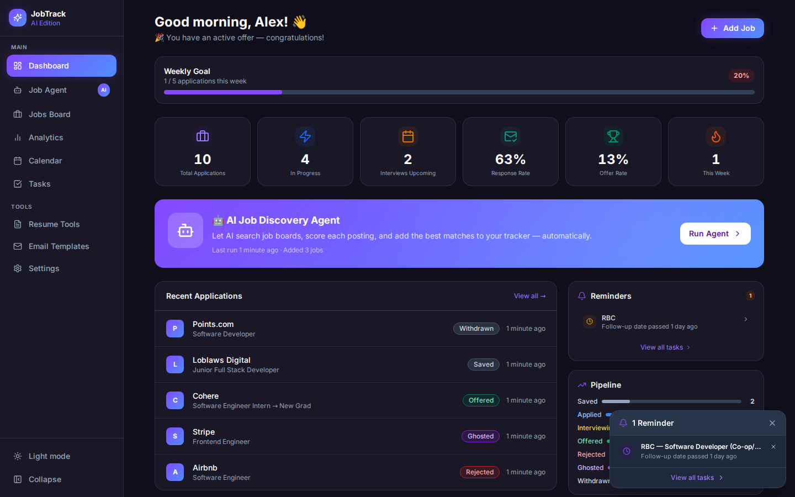
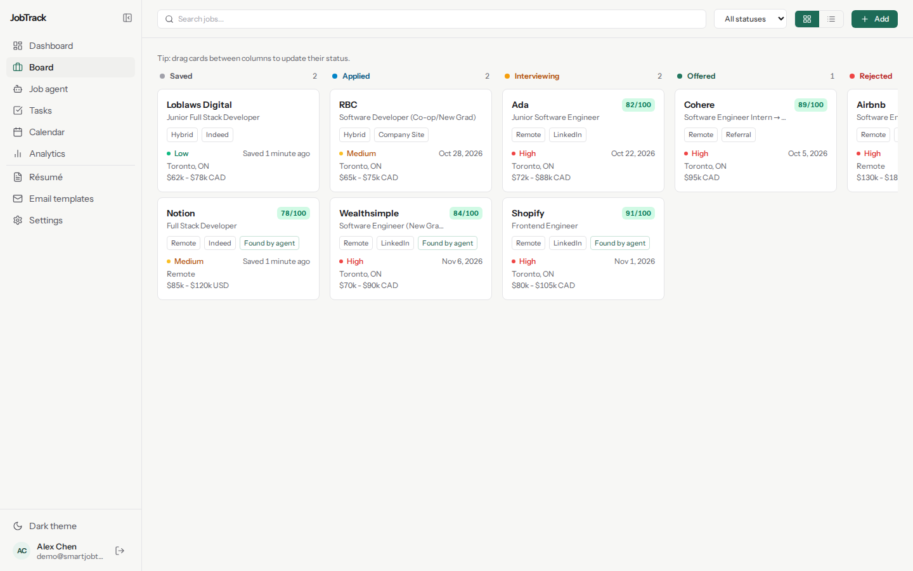
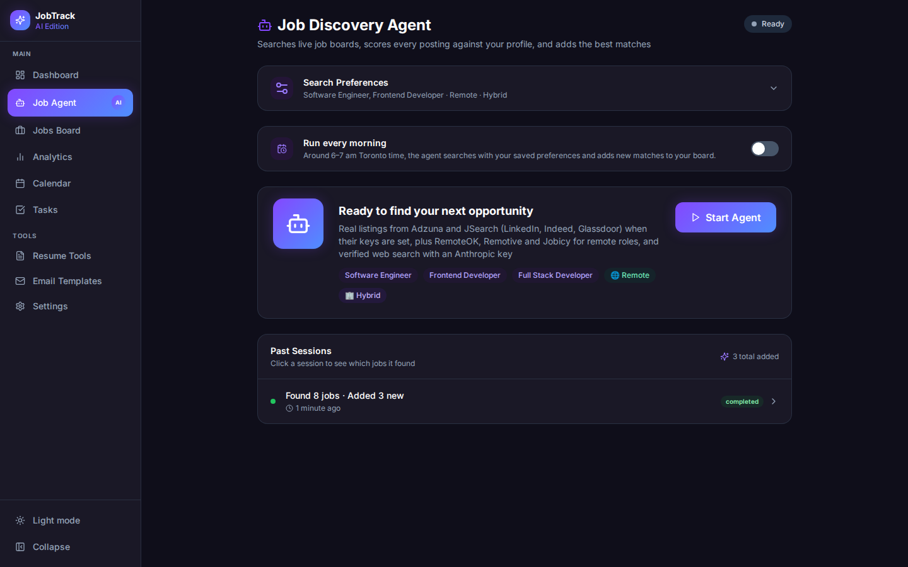
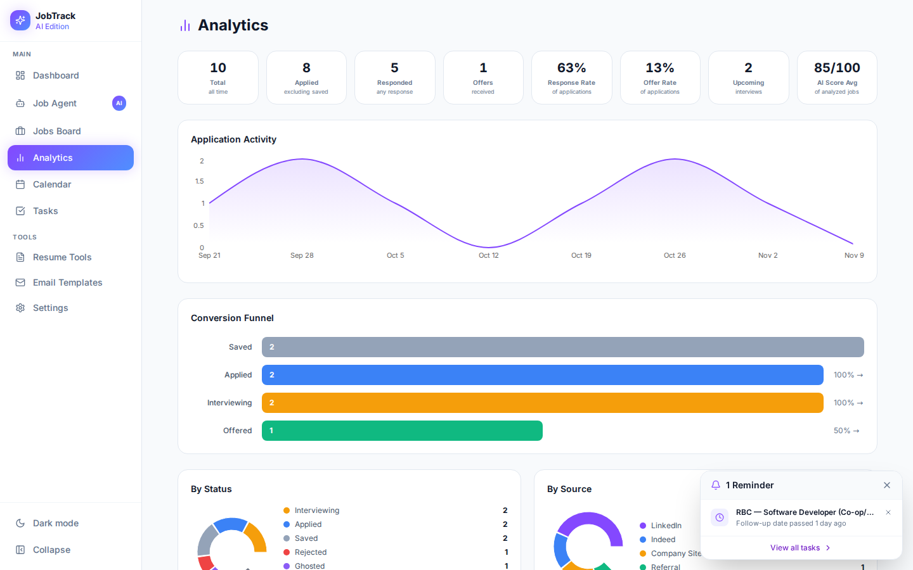
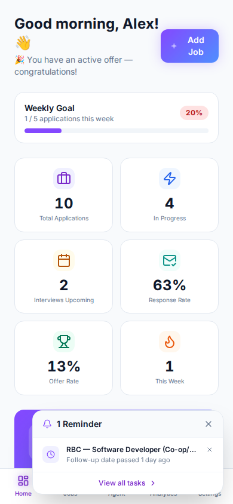
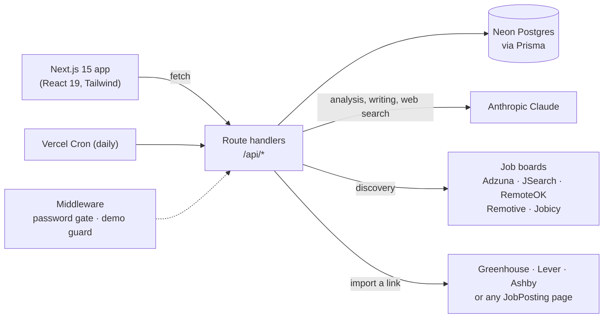

# Smart Job Tracker (JobTrack)

**An AI-powered job search assistant.** Tell it what roles you want and its **Job Agent** searches live job boards every morning, scores each posting against your skills, location and salary goals, and drops the best matches onto a drag-and-drop board. From there it helps you through the rest: importing postings from a link, tailored cover letters and resumes, interview prep, follow-ups and offer negotiation.

**[Try the live demo →](https://smart-job-tracker-demo.vercel.app)** (sample data, resets daily, no sign-up)

[](https://github.com/Sutavin2004/Smart-Job-Tracker/actions/workflows/ci.yml)
[](https://github.com/Sutavin2004/Smart-Job-Tracker/actions/workflows/e2e.yml)



| Jobs board | Job Agent |
|---|---|
|  |  |
| **Analytics** | **Mobile** |
|  |  |

## Features

### Find jobs
- **Job Agent**: searches Adzuna and JSearch (LinkedIn, Indeed, Glassdoor) when their keys are set, plus RemoteOK, Remotive and Jobicy for remote roles, and Claude with live web search when an Anthropic key is set. Progress streams live.
- **Runs every morning on its own** (optional): a Vercel Cron job runs the agent daily with your saved preferences.
- **Only real postings**: anything the AI finds must link to a page its web search actually returned, so invented listings are discarded.
- **Fit scoring** (0–100) on skills, title relevance, location, salary and experience. Irrelevant titles are dropped, remote roles restricted to another country are flagged, and every score comes with a plain-English reason.

### Track applications
- **Drag-and-drop board** (Saved → Applied → Interviewing → Offer …), keyboard accessible, with optimistic updates.
- **Add from a link**: paste a Greenhouse, Lever or Ashby URL (read through their public APIs) or any page with schema.org `JobPosting` data. Claude reads the page as a fallback.
- Interviews, contacts, tasks, salary negotiation rounds, notes, follow-up reminders, CSV export.
- **Dashboard and analytics**: weekly goal, response and offer rates, pipeline, activity heatmap, calendar.

### Apply with AI (Claude)
- Job analysis (strengths, risks, key skills), cover letters, resume tailoring, answers to application questions, interview prep, follow-up emails and salary advice.

### Quality
- **Tests**: 60 unit tests (Vitest) plus 42 end-to-end tests (Playwright) against a real Postgres, including **WCAG 2.1 AA accessibility checks (axe) on every page in light and dark mode**.
- **Security**: optional password gate (HMAC session cookie), SSRF-safe URL fetching, security headers, partial-update APIs, `npm audit` clean for production dependencies.
- **PWA**: installable on your phone; link previews when shared; dark mode; command palette (⌘K).

## Architecture



| Path | What lives there |
|------|------------------|
| `src/app/` | Pages (App Router) and API route handlers |
| `src/lib/agent/discover.ts` | The Job Agent pipeline shared by the manual and scheduled runs |
| `src/lib/scoring.ts` | Fit scoring, title relevance and remote-eligibility rules |
| `src/lib/job-boards/` | One adapter per job board |
| `src/lib/ats.ts`, `src/lib/job-import.ts` | Import from Greenhouse/Lever/Ashby APIs and schema.org data |
| `src/lib/safe-fetch.ts` | Fetching user-supplied URLs without reaching private networks |
| `e2e/` | Playwright end-to-end, accessibility and screenshot tests |

## Tech stack

Next.js 15 (App Router) · React 19 · TypeScript · Tailwind CSS · Radix UI · Recharts · @hello-pangea/dnd · Prisma 5 · PostgreSQL (Neon) · Anthropic Claude API · Vitest · Playwright + axe-core · Vercel (hosting, cron, analytics) · GitHub Actions

## Running locally

```bash
git clone https://github.com/Sutavin2004/Smart-Job-Tracker.git
cd Smart-Job-Tracker
npm install

cp .env.example .env      # fill in the values below
npx prisma migrate deploy # create the tables
npm run db:seed           # optional: sample data (replaces existing data)
npm run dev               # http://localhost:3000
```

### Environment variables

| Variable | Required | Purpose |
|----------|----------|---------|
| `DATABASE_URL` | Yes | Pooled Postgres connection string (Neon) |
| `DATABASE_URL_UNPOOLED` | Yes | Direct connection, used for migrations |
| `ANTHROPIC_API_KEY` | For AI features | Analysis, writing tools, and verified web search in the agent. Without it, AI endpoints return 503 and everything else works. |
| `ADZUNA_APP_ID`, `ADZUNA_APP_KEY` | Recommended | Local (non-remote) job listings; free at developer.adzuna.com |
| `RAPIDAPI_KEY` | Optional | JSearch (LinkedIn, Indeed, Glassdoor) |
| `APP_PASSWORD` | Recommended in production | Puts the app and API behind a password screen |
| `CRON_SECRET` | Optional | If set, the daily cron routes require it |
| `DEMO_MODE` | Demo only | `true` turns on the public demo behaviour (see below) |

On Vercel, the Neon integration sets both database variables automatically.

## Scripts

| Command | Description |
|---------|-------------|
| `npm run dev` | Dev server |
| `npm run build` | Production build |
| `npm test` | Unit tests (Vitest) |
| `npm run test:e2e` | End-to-end tests (needs a seeded database and a build) |
| `npm run type-check` / `npm run lint` | TypeScript / ESLint |
| `npm run db:migrate` | Create a migration during development |
| `npm run db:seed` | Load sample data |

## Deployment

- **App**: Vercel with a Neon Postgres database. `vercel.json` runs `prisma migrate deploy` before each build and registers the daily cron jobs.
- **Public demo**: a second Vercel project from the same repo with its own database and `DEMO_MODE=true`. It shows a banner, re-seeds sample data on each deploy and every day, blocks link import, and rate-limits the agent. No API keys are set, so it costs nothing to run.
- **CI** (GitHub Actions): type-check, unit tests, lint and build on every push; Playwright E2E and accessibility tests against Postgres 16. The *Update README screenshots* workflow regenerates the images above.
